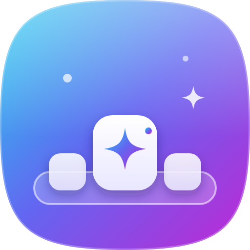

<p align="center"></p>

<h1 align="center">Lanzadera</h1>

<p align="center"><b>Un dock organizador para el escritorio de Windows 11.</b><br>
Una barra con tus programas, carpetas y archivos que crece cuando pasas el mouse, con grupos que se abren en más iconos, espacios de trabajo, buscador rápido y un organizador del escritorio.</p>

---

## Descargar e instalar

1. Entra a **[Releases](https://github.com/fernandhinoquim-tech/lanzadera/releases/latest)** y descarga `Lanzadera-Setup-X.Y.Z.exe`.
2. Ábrelo. Como la app no tiene una firma digital pagada, Windows puede mostrar **«Windows protegió su PC»**. Haz clic en **Más información → Ejecutar de todas formas**.
3. Se instala en segundos (sin permisos de administrador) y se abre la bienvenida.

Las **actualizaciones son automáticas**: cuando hay una versión nueva, Lanzadera la descarga sola y te avisa para reiniciar.

## Qué hace

| | Función | Cómo se usa |
|---|---|---|
| 🔍 | **Efecto lupa** | Los iconos crecen al pasar el mouse. En modo *compacto* la barra es pequeña y se agranda al tocarla. |
| 📍 | **Cualquier borde** | Abajo, arriba, izquierda o derecha; alineada al inicio, centro o final; en una o en todas las pantallas. |
| 👁️ | **Modos de reposo** | Siempre visible, compacta, *mini* (una línea de color) u oculta (aparece al llevar el mouse al borde). |
| 🪟 | **No tapa tus ventanas** | Reserva su franja como la barra de tareas: las ventanas maximizadas terminan justo arriba. También puede esconderse cuando una ventana lo toca, quedar **al fondo en el escritorio** (detrás de tus ventanas) o encima de todo. |
| ⭐ | **Barra en dos zonas** | Primero tus programas más usados (según el uso real en Windows) y después tus grupos de accesos directos. |
| 🗂️ | **Grupos** | Un icono que abre muchos más, en **abanico**, **cuadrícula** o **lista**. Suelta un icono sobre otro para crear uno, o arma grupos por tema con los accesos de tu escritorio. «Abrir todo» lanza el grupo completo. |
| 🟢 | **Programas abiertos** | Un punto marca lo que está abierto; un clic vuelve a su ventana (o la minimiza si ya estaba al frente). `Mayús + clic` abre otra. |
| 📥 | **Carpetas en vivo** | Descargas, Documentos o cualquier carpeta, con miniaturas y un contador de archivos nuevos. |
| 🕘 | **Recientes** | Los últimos archivos que abriste en Windows. |
| 🧺 | **Estante** | Suelta archivos ahí para tenerlos a mano; luego arrástralos a otra carpeta, correo o programa. |
| 🧩 | **Espacios de trabajo** | Un dock distinto para *Trabajo*, *Estudio*, *Ocio*… Cambia con `Ctrl + Mayús + Alt + 1…9` o la rueda del mouse. |
| ⚡ | **Buscador rápido** | `Alt + Espacio`: apps, archivos, ajustes de Windows, comandos y **cuentas** (`80*15%`). `Ctrl + P` fija el resultado. |
| ✨ | **Ordenar escritorio** | Acomoda los archivos sueltos en carpetas por tipo (Imágenes, PDF, Música…). Muestra una vista previa y **siempre se puede deshacer**. |
| 🎨 | **Iconos 3D** | 1.238 iconos 3D al estilo de Windows 11 (Fluent de Microsoft) con buscador en español, como objeto libre o sobre mosaico. |
| ✏️ | **Iconos de línea** | Banco de 1.850 iconos con 7 estilos (Degradado, Brillante 3D, Vidrio, Neón, Pastel, Sólido, Mínimo), 19 degradados, colores propios, emoji, letras, o **tus propias imágenes**. |
| 📈 | **Monitor de rendimiento** | Un panel en el escritorio con medidores de CPU, RAM y gráfica, red y disco, y **temperaturas** del procesador, la tarjeta gráfica y los SSD en medidores con zona verde, amarilla (cuidado) y roja (crítico). La del procesador necesita LibreHardwareMonitor, HWiNFO u OpenHardwareMonitor abiertos, porque Windows solo la entrega a programas con permisos de administrador. Al pasar el puntero muestra el detalle; avisa si algo se calienta demasiado. |
| 🖼️ | **Iconos originales en HD** | Los iconos de tus programas se extraen de Windows a 256 px para que se vean nítidos al agrandarse. |
| ⏰ | **Widgets** | Reloj con calendario, historial del portapapeles y notas rápidas. |
| 🤖 | **Sugerencias** | El icono «Sugeridas» aprende qué programas usas a cada hora. |
| 🗑️ | **Papelera** | Suelta archivos sobre ella para borrarlos (van a la Papelera de reciclaje). |
| 💾 | **Copia de seguridad** | Exporta e importa toda tu configuración, incluidas tus imágenes. |

## Atajos

| Atajo | Acción |
|---|---|
| `Alt + Espacio` | Abrir el buscador (si otro programa lo usa, se usa `Ctrl + Alt + Espacio`) |
| `Ctrl + Alt + D` | Mostrar u ocultar el dock |
| `Ctrl + Mayús + Alt + 1…9` | Cambiar de espacio de trabajo |
| Clic derecho | Menú con todas las opciones (sobre el dock o un icono) |
| `Ctrl + Mayús + clic` | Abrir un programa como administrador |
| Arrastrar un icono fuera del dock | Quitarlo (con «Deshacer») |
| Soltar un icono sobre otro (y esperar) | Crear un grupo con los dos |
| `Mayús + clic` o clic central | Abrir otra ventana de un programa ya abierto |

Todos los atajos se pueden cambiar en **Configuración → Comportamiento**.

## Privacidad

- Todo se guarda **solo en tu equipo** (`%APPDATA%\Lanzadera`).
- El historial del portapapeles vive en memoria y respeta a los gestores de contraseñas que piden no ser registrados. Puedes apagarlo en **Widgets**.
- Para proponerte tus programas más usados, Lanzadera lee el registro de uso que Windows guarda en tu equipo; ese dato no sale de tu PC.
- Lanzadera solo se conecta a Internet para buscar actualizaciones en este repositorio.

## Para desarrolladores

```bash
npm install
npm start          # abre la app
npm test           # pruebas unitarias
npm run dist       # crea el instalador (en Windows)
```

- `src/main` — proceso principal (ventanas, iconos de Windows, organizador, buscador, portapapeles).
- `src/renderer/dock` — la barra; `panel` — configuración; `search` — buscador; `monitor` — monitor de rendimiento; `shared` — iconos de diseño y gráficas.
- `resources/win/helper.ps1` — extrae iconos a 256 px, lista las apps del menú Inicio, recoge las métricas del PC (CPU, GPU, red, disco, temperaturas) y detecta juegos o videos en pantalla completa.
- Cada cambio en `main` compila el instalador en Windows (GitHub Actions) y ejecuta una prueba de humo que abre la app real y guarda capturas en la rama `ci-reports`. Para publicar en *Releases*, sube la versión en `package.json` y escribe `[publicar]` en el mensaje del commit, o ejecuta el flujo a mano marcando «publicar»; solo se publica si la prueba de humo pasa.

## Licencia

MIT. Iconos del banco: [Lucide](https://lucide.dev) (ISC). Ver [THIRD_PARTY_NOTICES.md](THIRD_PARTY_NOTICES.md).
